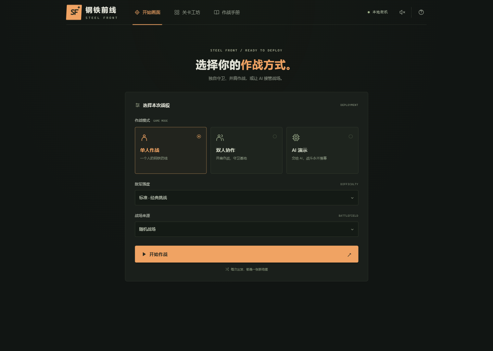
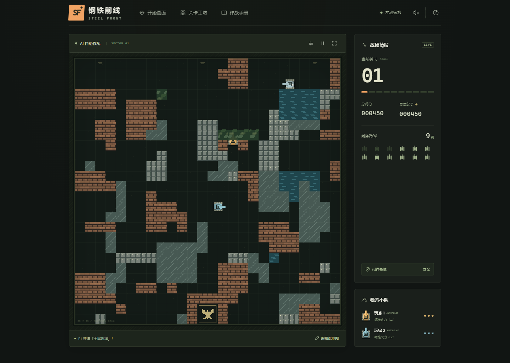
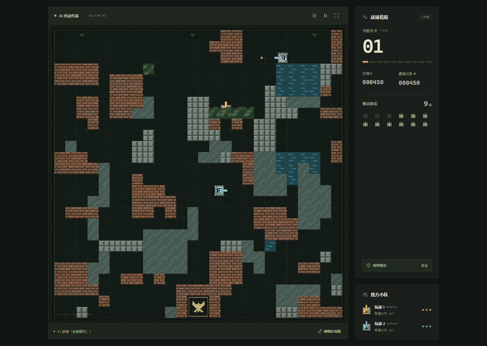
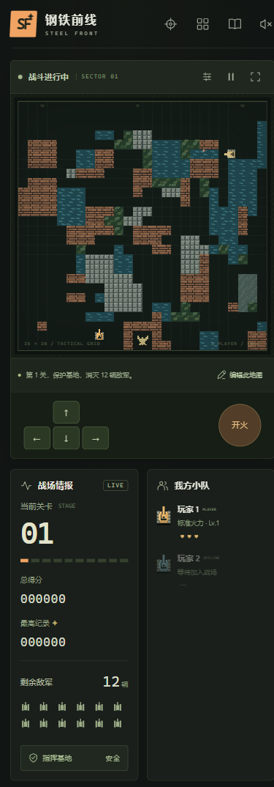

# 钢铁前线 · STEEL FRONT

[](https://github.com/DeronQi/tank-battle-game-codex/actions/workflows/ci.yml)
[](LICENSE)

[English](docs/README.en.md) · [玩法与关卡工坊](docs/PLAYING.md) · [架构](docs/ARCHITECTURE.md) · [测试](docs/TESTING.md) · [验证记录](VERIFICATION.md)

一款 FC 风格的浏览器坦克大战：双人同屏、随机战场、七种道具、关卡编辑器，以及能守家、闪避、对射和拾取补给的单 / 双 AI 演示。

使用原生 JavaScript、Canvas 2D 和 Web Audio，无第三方运行依赖。游戏图形和音效由代码绘制、合成，无需账户、外部 API 或网络联机服务。


## 快速开始

需要 **Node.js 20 或更新版本**，无需执行 `npm install`：

```sh
git clone https://github.com/DeronQi/tank-battle-game-codex.git
cd tank-battle-game-codex
npm start
```

浏览器打开终端显示的地址，默认为 **http://127.0.0.1:5173**。端口被占用时：

```sh
npm start -- --port 5187
```

通过开始画面选择模式、敌军强度和地图来源，然后点击「开始作战」。请通过 HTTP 访问，直接双击 HTML 的 `file://` 方式不受支持。

## 玩法

| 能力 | 内容 |
|---|---|
| 作战模式 | 单人、同设备双人协作、1 或 2 个 AI 演示 |
| 敌军 | 侦察、突击、速射、重装四类，装甲、速度、火力与得分不同 |
| 补给 | 火力、护盾、轰炸、生命、冻结、基地加固、加速 |
| 战场 | 26 × 26 随机地图，砖墙、钢墙、水域、树林、冰面与空地 |
| 工坊 | 画笔、擦除、撤销、随机生成、本地保存、JSON 导入导出 |
| 续关 | 胜利进入下一张随机地图；失败重试本关原始地图 |
| 界面 | 独立开局选择、游戏区与状态栏、帮助、暂停、音效、整体全屏 |
| 移动端 | 响应式布局与 P1 触控移动 / 开火；双人建议使用桌面键盘 |

### 操作

| 操作 | 玩家 1 | 玩家 2 |
|---|---|---|
| 移动 | W / A / S / D | 方向键 |
| 开火 | 空格 | Enter |

长按开火可连续射击；**P** 暂停 / 继续，**M** 切换音效。友军免伤。基地被毁或全体玩家耗尽生命即失败，消灭全部敌军即可通关。

失败会恢复本关开始时的地图、得分、生命和火力；重复挑战重新随机敌军行动。AI 演示在结果出现约 3.5 秒后自动续关或重试。

### AI 演示

AI 的优先级是 **基地安全 → 自身安全 → 主动行动**：

- 优先拦截射向基地的炮弹，能对射则抵消，必要时以车体挡弹。
- 预测炮弹与交叉火力，结合墙体、装填和弹数限制选择避让或迎击。
- 安全时寻找射击位置、打通砖墙、绕钢墙侧击，双 AI 协调目标与前后支援。
- 按当前需求、实际路线和道具消失时间评估七种补给，基地告急时中止拾取。

AI 为内置规则算法，不使用大模型或外部服务，仍可能失守。

## 界面截图

以下均来自本项目实际运行的 Chromium 页面，使用固定种子复现。

### 开始选择



### 双 AI 自动演示



### 关卡工坊


<details>
<summary>查看整体全屏与移动端截图</summary>





</details>

截图的复现方法见 [测试文档](docs/TESTING.md)，文件与来源见 [截图说明](docs/screenshots/README.md)。

## 自定义关卡与存储

进入「关卡工坊」绘制并保存，点击「保存并开始作战」，或在开始画面选择「自定义关卡」。自定义地图作为战役第一关，后续胜利关卡随机生成。

随机生成器使用自然地形斑块和局部连通修复，不预设贯穿道路，也不限制自然形成的直线射界。相同种子在同一生成器版本内可复现；要长期保留地图，请导出 JSON。

最高分、音效偏好和一张自定义地图保存在当前浏览器的 Local Storage。覆盖地图前可先导出；清理站点数据会移除本地记录。详见 [玩法与地图格式](docs/PLAYING.md)。

## 开发与验证

```sh
npm run check
npm test
node scripts/benchmark-ai.mjs
```

当前包含 **50 项核心测试**。GitHub Actions 在 Node.js 20、22、24 下执行语法和回归检查。浏览器交互、全屏、续关、拾取与截图有单独的 Playwright CLI 脚本，见 [测试文档](docs/TESTING.md)。

[验证记录](VERIFICATION.md) 区分引擎测试、固定样本采样与实际浏览器检查；[采样快照](docs/benchmarks/ai-benchmark.json) 提供可检查的数据。固定样本不代表所有地图、强度或设备。

欢迎通过 Issues 报告问题或提交改进，参见 [参与贡献](CONTRIBUTING.md)。

## 部署

也可将 `index.html`、`src/`、`public/` 放到静态网站根目录。当前资源路径按根目录组织；子路径部署需调整资源路径。本项目的本地开发服务器只监听 `127.0.0.1`，不作为公网生产服务器。

## 许可证

本项目使用 [MIT 许可证](LICENSE)，允许复用、修改和分发，需保留版权与许可声明。
