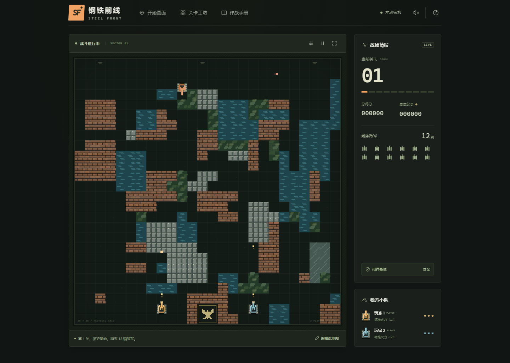
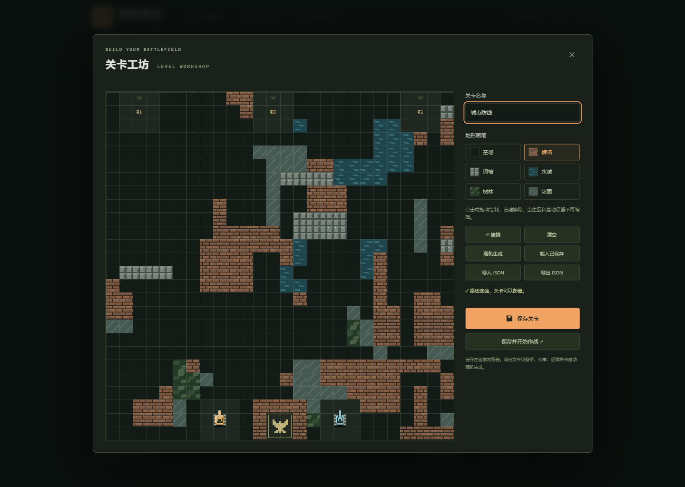

# STEEL FRONT

[中文](../README.md) · [Architecture](ARCHITECTURE.md) · [Testing](TESTING.md)

A browser tank battle game inspired by classic console gameplay. Built with vanilla JavaScript, Canvas 2D and Web Audio, with no third-party runtime dependencies.



## Run locally

Requires Node.js 20 or newer. No package installation is needed.

```sh
git clone https://github.com/DeronQi/tank-battle-game-codex.git
cd tank-battle-game-codex
npm start
```

Open `http://127.0.0.1:5173`. If that port is busy, run `npm start -- --port 5187` and open the address printed in the terminal. Serve over HTTP; opening the HTML directly via `file://` is unsupported.

## Features

- Single player and local two-player co-op, with friendly fire disabled.
- Four enemy classes and seven random powerups.
- Procedural 26 × 26 battlefields with brick, steel, water, forest, ice and open ground.
- Level editor with painting, erasing, undo, generation, local save and JSON import/export.
- One- or two-player AI demonstrations using built-in rules, pathfinding and shell prediction.
- Victory advances to a new random level. Defeat retries the original map and restores the stage-entry state.
- AI automatically advances or retries after a short result countdown.
- Pause, synthesized audio, fullscreen including the status sidebar, responsive layout and P1 touch controls.

## Controls

| Action | Player 1 | Player 2 |
|---|---|---|
| Move | W / A / S / D | Arrow keys |
| Fire | Space | Enter |

Hold fire for repeated shots. **P** pauses/resumes, **M** toggles audio. Protect the base and destroy all enemies. Co-op runs on one device; network multiplayer is not included.

AI prioritizes the base, then its own safety, then active combat and useful pickups. It can counter incoming shells, block shots with its hull, evade crossfire, find firing positions and coordinate powerup collection. It uses no external model or service and can still lose.

## Editor



Custom maps use a 26 × 26 integer grid in the exported `steel-front` JSON format. Use the editor to validate, save and export a map. Custom terrain is used for the first stage and its retries; subsequent won stages use random terrain.

High scores, audio preference and one saved map remain in the current browser's Local Storage. Export maps for durable backups and sharing. The UI and detailed in-game guide are currently in Chinese.

## Development

```sh
npm run check
npm test
node scripts/benchmark-ai.mjs
```

The project includes 50 core regression tests. Browser verification and screenshot commands are documented in [Testing](TESTING.md); results and their limits are recorded in [Verification](../VERIFICATION.md).

The game can also be served from a static website root. Current asset paths assume root deployment; hosting under a subpath requires updating those paths. The included development server binds only to `127.0.0.1`.

See [Contributing](../CONTRIBUTING.md) for bug reports and changes.

## License

[MIT](../LICENSE). Retain the copyright and permission notice when reusing or distributing the project.
